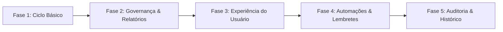

# Plano de Ação para Evolução Completa — ESDEP-MT

Plano estratégico e técnico para transformar o sistema de reservas da **ESDEP-MT** em uma plataforma corporativa completa, robusta e pronta para produção institucional na Defensoria Pública.

---

## 🧭 Visão Geral das Fases

---

## 📌 Fase 1: Ciclo Administrativo & Consulta Pública (Alta Prioridade)

### 1.1 Gestão de Salas (`/admin/rooms`)
- **Objetivo**: Permitir que administradores gerenciem os espaços físicos diretamente pelo painel, sem necessidade de seeders.
- **Funcionalidades**:
  - Listagem com paginação e busca por nome/código.
  - Modal de Criação e Edição de sala (Nome, Código único, Capacidade máxima, Cor temática para calendário, Descrição, Status Ativo/Inativo).
  - Toggle rápido de ativação/desativação (para salas em manutenção/reforma).
  - Exclusão segura (apenas para salas sem histórico de reservas).
- **Arquivos**:
  - `[NEW]` [`app/Livewire/Admin/RoomManager.php`](file:///c:/Users/Defensoria/Herd/ESDEP-MT/app/Livewire/Admin/RoomManager.php)
  - `[NEW]` `resources/views/livewire/admin/room-manager.blade.php`
  - `[MODIFY]` [`routes/web.php`](file:///c:/Users/Defensoria/Herd/ESDEP-MT/routes/web.php) (adicionar rota `/admin/rooms`)
  - `[MODIFY]` [`resources/views/components/layouts/app.blade.php`](file:///c:/Users/Defensoria/Herd/ESDEP-MT/resources/views/components/layouts/app.blade.php) (adicionar link de navegação para Salas)

**Status**: ✅ COMPLETA

---

### 1.2 Protocolo Amigável & Consulta Pública (`/consultar`)
- **Objetivo**: Permitir que o servidor ou solicitante externo acompanhe o andamento da sua solicitação sem precisar de autenticação.
- **Funcionalidades**:
  - Gerar protocolo único automático ao criar a reserva (ex: `RES-2026-0042`).
  - Tela pública simples e elegante para digitar o protocolo ou e-mail.
  - Visualização do status atual (Pendente, Autorizada, Rejeitada com justificativa, Em andamento), sala, horários e serviços solicitados.
  - Inclusão do protocolo no e-mail de confirmação de envio.
- **Arquivos**:
  - `[NEW]` Migration para adicionar coluna `protocol` única na tabela `reservations`.
  - `[NEW]` [`app/Livewire/Public/ReservationStatusCheck.php`](file:///c:/Users/Defensoria/Herd/ESDEP-MT/app/Livewire/Public/ReservationStatusCheck.php)
  - `[NEW]` `resources/views/livewire/public/reservation-status-check.blade.php`
  - `[MODIFY]` [`app/Actions/CreateReservationAction.php`](file:///c:/Users/Defensoria/Herd/ESDEP-MT/app/Actions/CreateReservationAction.php) (geração do protocolo)
  - `[MODIFY]` [`routes/web.php`](file:///c:/Users/Defensoria/Herd/ESDEP-MT/routes/web.php) (adicionar rota `/consultar`)

**Status**: ✅ COMPLETA

---

### 1.3 Gestão de Usuários Administradores (`/admin/users`)
- **Objetivo**: Gerenciar os operadores do sistema com controle de papéis (`super-admin`, `admin`, `manager`).
- **Funcionalidades**:
  - Listagem de operadores e administradores.
  - Cadastro de novos administradores com definição de papel e envio de senha inicial ou redefinição.
  - Bloqueio/inativação de acessos.
- **Arquivos**:
  - `[REMOVED]` Esta funcionalidade foi removida e sera gerenciada pela pagina de Contatos.

**Status**: ❌ REMOVIDA

---

## 📌 Fase 2: Governança, Auditoria & Relatórios (Média Prioridade)

### 2.1 Log de Auditoria / Histórico de Reservas (Activity Log)
- **Objetivo**: Garantir conformidade pública com histórico imutável de todas as ações em reservas.
- **Funcionalidades**:
  - Registrar quem aprovou, rejeitou, reabriu ou editou cada reserva, com timestamp e justificativa.
  - Exibição de uma timeline de histórico dentro do modal de detalhes da reserva no painel admin.
- **Arquivos**:
  - `[NEW]` Migration `create_reservation_logs_table` (`reservation_id`, `user_id`, `action`, `changes`, `reason`, `created_at`).
  - `[NEW]` [`app/Models/ReservationLog.php`](file:///c:/Users/Defensoria/Herd/ESDEP-MT/app/Models/ReservationLog.php)
  - `[MODIFY]` Actions de reserva (`ApproveReservationAction`, `RejectReservationAction`, `UpdateReservationAction`).
  - `[MODIFY]` [`app/Livewire/Admin/ReservationManager.php`](file:///c:/Users/Defensoria/Herd/ESDEP-MT/app/Livewire/Admin/ReservationManager.php) (eager loading de logs)
  - `[MODIFY]` [`resources/views/livewire/admin/reservation-manager.blade.php`](file:///c:/Users/Defensoria/Herd/ESDEP-MT/resources/views/livewire/admin/reservation-manager.blade.php) (timeline de logs)

**Status**: ✅ COMPLETA

---

### 2.2 Exportação de Relatórios & Integração de Calendário
- **Funcionalidades**:
  - **Exportação CSV/Excel**: Relatório gerencial de uso das salas por período (reservas realizadas, taxa de ocupação, participantes totais).
  - **Integração `.ics`**: Gerador de arquivo de calendário para permitir que o solicitante adicione ao Google Calendar / Outlook com 1 clique direto do e-mail de aprovação.
- **Arquivos**:
  - `[NEW]` [`app/Services/IcsCalendarGenerator.php`](file:///c:/Users/Defensoria/Herd/ESDEP-MT/app/Services/IcsCalendarGenerator.php)
  - `[NEW]` [`app/Livewire/Admin/Reports.php`](file:///c:/Users/Defensoria/Herd/ESDEP-MT/app/Livewire/Admin/Reports.php)
  - `[NEW]` `resources/views/livewire/admin/reports.blade.php`
  - `[MODIFY]` [`routes/web.php`](file:///c:/Users/Defensoria/Herd/ESDEP-MT/routes/web.php) (adicionar rota `/admin/reports`)
  - `[MODIFY]` [`resources/views/components/layouts/app.blade.php`](file:///c:/Users/Defensoria/Herd/ESDEP-MT/resources/views/components/layouts/app.blade.php) (adicionar link de navegação)
  - `[MODIFY]` [`app/Mail/ReservationApprovedMail.php`](file:///c:/Users/Defensoria/Herd/ESDEP-MT/app/Mail/ReservationApprovedMail.php) (anexar .ics)

**Status**: ✅ COMPLETA

---

## 📌 Fase 3: Experiência do Solicitante & Anexos

### 3.1 Upload de Documentos Anexos
- **Funcionalidades**:
  - Campo opcional no formulário de reserva para anexar **Ofício de Solicitação** ou **Cronograma do Evento** (PDF, PNG, JPG até 5MB).
  - Download e visualização segura pelo administrador no painel.
- **Arquivos**:
  - `[NEW]` Migration para adicionar `attachment_path`, `attachment_name` e `reminder_sent_at` em `reservations`.
  - `[MODIFY]` [`app/Livewire/Public/BookingForm.php`](file:///c:/Users/Defensoria/Herd/ESDEP-MT/app/Livewire/Public/BookingForm.php) com `Livewire\WithFileUploads`.
  - `[MODIFY]` [`resources/views/livewire/public/booking-form.blade.php`](file:///c:/Users/Defensoria/Herd/ESDEP-MT/resources/views/livewire/public/booking-form.blade.php) (campo de upload)
  - `[MODIFY]` [`app/Models/Reservation.php`](file:///c:/Users/Defensoria/Herd/ESDEP-MT/app/Models/Reservation.php) (fillable + casts)

**Status**: ✅ COMPLETA

---

### 3.2 Termo de Compromisso e Regras de Uso
- **Funcionalidades**:
  - Modal ou checkbox interativo no formulário público com regras da ESDEP (conservação de equipamentos, cancelamento prévio, pontualidade).
  - Registro de aceite no banco de dados.
- **Arquivos**:
  - `[NEW]` Migration para adicionar `terms_accepted` e `terms_accepted_at` em `reservations`.
  - `[MODIFY]` [`app/Livewire/Public/BookingForm.php`](file:///c:/Users/Defensoria/Herd/ESDEP-MT/app/Livewire/Public/BookingForm.php) (validação e métodos de termos)
  - `[MODIFY]` [`resources/views/livewire/public/booking-form.blade.php`](file:///c:/Users/Defensoria/Herd/ESDEP-MT/resources/views/livewire/public/booking-form.blade.php) (checkbox e modal de termos)
  - `[MODIFY]` [`app/Actions/CreateReservationAction.php`](file:///c:/Users/Defensoria/Herd/ESDEP-MT/app/Actions/CreateReservationAction.php) (salvar aceite)
  - `[MODIFY]` [`app/Models/Reservation.php`](file:///c:/Users/Defensoria/Herd/ESDEP-MT/app/Models/Reservation.php) (fillable + casts)

**Status**: ✅ COMPLETA

---

## 📌 Fase 4: Automações & Rotinas em Background

### 4.1 Scheduler de Lembretes e Manutenção
- **Funcionalidades**:
  - Comando agendado diário que dispara e-mail de lembrete aos solicitantes com eventos nas próximas 24h.
  - Rotina de marcação automática de eventos passados.
- **Arquivos**:
  - `[NEW]` `app/Console/Commands/SendReservationRemindersCommand.php`
  - `[NEW]` `app/Mail/ReservationReminderMail.php`
  - `[NEW]` `resources/views/emails/reservation-reminder.blade.php`
  - `[NEW]` Migration `add_reminder_sent_at_to_reservations_table`
  - `[MODIFY]` [`routes/console.php`](file:///c:/Users/Defensoria/Herd/ESDEP-MT/routes/console.php) (agendamento)
  - `[MODIFY]` [`app/Models/Reservation.php`](file:///c:/Users/Defensoria/Herd/ESDEP-MT/app/Models/Reservation.php) (fillable + casts)

**Status**: ✅ COMPLETA

---

## 📌 Fase 5: Auditoria & Histórico Completo

### 5.1 Histórico de Atividades (`/admin/activity`)
- **Objetivo**: Registrar e exibir todas as ações realizadas no sistema (reservas, usuários, salas, contatos).
- **Funcionalidades**:
  - Tabela com: Ação, Descrição, Agenda/Tipo, Usuário, Data/Hora, Detalhes.
  - Filtros por tipo de ação (criação, atualização, aprovação, rejeição, exclusão).
  - Filtros por tipo de objeto (reservas, usuários, salas, contatos).
  - Filtros por período (data início e fim).
  - Busca por descrição ou nome do usuário.
  - Estatísticas (total, hoje, esta semana, reservas).
  - Modal de detalhes com mudanças (antes/depois).
- **Arquivos**:
  - `[NEW]` Migration `create_activity_logs_table` (`action`, `description`, `subject_type`, `subject_id`, `user_id`, `changes`, `metadata`, `created_at`).
  - `[NEW]` [`app/Models/ActivityLog.php`](file:///c:/Users/Defensoria/Herd/ESDEP-MT/app/Models/ActivityLog.php)
  - `[NEW]` [`app/Services/ActivityLogger.php`](file:///c:/Users/Defensoria/Herd/ESDEP-MT/app/Services/ActivityLogger.php)
  - `[NEW]` [`app/Livewire/Admin/ActivityLogController.php`](file:///c:/Users/Defensoria/Herd/ESDEP-MT/app/Livewire/Admin/ActivityLogController.php)
  - `[NEW]` `resources/views/livewire/admin/activity-log.blade.php`
  - `[MODIFY]` [`routes/web.php`](file:///c:/Users/Defensoria/Herd/ESDEP-MT/routes/web.php) (adicionar rota `/admin/activity`)
  - `[MODIFY]` [`resources/views/components/layouts/app.blade.php`](file:///c:/Users/Defensoria/Herd/ESDEP-MT/resources/views/components/layouts/app.blade.php) (adicionar link de navegação)
  - `[MODIFY]` Actions de reserva (`CreateReservationAction`, `ApproveReservationAction`, `RejectReservationAction`, `UpdateReservationAction`)

**Status**: ✅ COMPLETA

---

## 🧪 Plano de Verificação e Qualidade

Para cada fase implementada:
1. **Testes Unitários e Feature (Pest)**: Criar testes para novas rotas, validações de formulário e ações.
2. **Análise Estática (PHPStan Nível 5)**: Manter 0 erros em todo o código adicionado.
3. **Padrões de UI**: Seguir as cores oficiais ESDEP (`#003f32`, `#008b5c`, `#4fd1a5`), modo escuro e convenção de toasts Alpine.

---

## 📊 Resumo de Progresso

| Fase | Descrição | Status |
|------|-----------|--------|
| 1.1 | Gestão de Salas | ✅ Completa |
| 1.2 | Protocolo Amigável | ✅ Completa |
| 1.3 | Gestão de Usuários | ❌ Removida |
| 2.1 | Log de Auditoria | ✅ Completa |
| 2.2 | Relatórios e ICS | ✅ Completa |
| 3.1 | Upload de Documentos | ✅ Completa |
| 3.2 | Termo de Compromisso | ✅ Completa |
| 4.1 | Scheduler de Lembretes | ✅ Completa |
| 5.1 | Histórico de Atividades | ✅ Completa |
